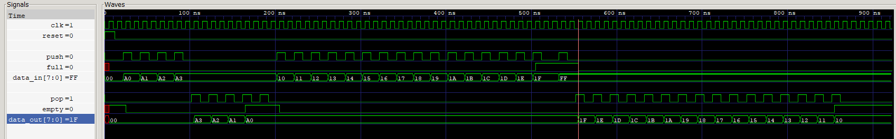

# Synchronous LIFO (Hardware Stack) with Triple Verification Suite

A 16-deep, 8-bit wide **Last-In-First-Out (LIFO / Stack)** memory buffer designed in Verilog, verified through three complementary methods:
1. **Directed Testing**: Self-checking Verilog testbench with 22 targeted corner-case scenarios
2. **Constrained-Random Verification (CRV)**: Layered SystemVerilog OOP testbench (IEEE 1800)
3. **Formal Property Verification (SVA)**: SymbiYosys + Z3 SMT solver (BMC, k-induction proof, cover)

---

## 📌 Features & Specifications

- **Memory Organization**: 16 entries $\times$ 8 bits (`mem_array [15:0]`).
- **Clocking & Reset**: Fully synchronous active-high reset.
- **Operations**:
  - `PUSH`: Pushes 8-bit data into the stack; auto-protected against overflow.
  - `POP`: Retrieves the most recently pushed element; auto-protected against underflow.
  - `PUSH + POP`: Replaces/overwrites the top of the stack simultaneously without altering pointer depth. On an empty stack, `data_in` passes straight through to `data_out`.
  - `PEEK` (`peek_data`): Real-time combinational visibility of the current top-of-stack without removing it.
- **Status Flags**:
  - `empty`: Asserted when pointer is `0x00`.
  - `full`: Asserted when pointer is `0x10` (16 entries).

> ⚠️ **Known issue:** When the stack is **full**, the RTL currently ignores `PUSH + POP` instead of overwriting the top (`LIFO.v`, `if(!empty && !full)`). This is caught by the directed testbench (cases 14, 15, 22). Fix: change the condition to `if(!empty)`.

---

## 📁 Repository Structure

```
├── LIFO.v                  # LIFO RTL design + inline formal verification block
├── tb_LIFO.v               # Self-checking directed Verilog testbench (22 cases, Icarus Verilog compatible)
├── lifo_if.sv              # SystemVerilog Interface with DRIVER, MONITOR, and DUT modports
├── lifo_transaction.sv     # Transaction packet with randomization (post_randomize) and copy methods
├── lifo_generator.sv       # Stimulus Generator with typed mailbox and completion handshake
├── lifo_driver.sv          # Synchronous pin-level Driver
├── lifo_monitor.sv         # Passive interface Monitor forwarding packets to Scoreboard
├── lifo_scoreboard.sv      # Golden reference stack model and automated checker
├── lifo_agent.sv           # Verification Agent encapsulating Generator, Driver, and Monitor
├── lifo_environment.sv     # Testbench Environment (pre_test, test, post_test phases)
├── tb_top.sv               # Top-level SystemVerilog testbench runner (250 transactions)
├── lifo_sva.sv             # SystemVerilog Assertions (SVA) module
├── lifo_formal.sv          # Top wrapper for formal verification
├── lifo.sby                # SymbiYosys configuration file (BMC, Prove, Cover)
├── waveform.png            # GTKWave simulation waveform snapshot
└── .gitignore              # Ignores simulation and formal artifacts
```

---

## ✅ Verification Results Summary

| Method | Tool | Scope | Result |
|:---|:---|:---|:---|
| **Directed** | Icarus Verilog 12 | 22 cases, 236 cycle-by-cycle checks | **19 / 22 cases**, 231 / 236 checks ❌ (Push+Pop on full) |
| **CRV** | Verilator 5.032 | 250 transactions (230 non-idle checked) | **909 / 909 checks** ✅ |
| **Formal (SVA)** | SymbiYosys + Yosys 0.52 + Z3 | 15 inline assertions, 3 covers | **BMC / Prove / Cover PASS** ✅ |

All 5 directed mismatches trace back to the single known issue above. The CRV and formal suites do not currently detect it: the random run did not reach a full stack, and the formal properties check the pointer and flags but not the stored data.

---

## 🎯 Directed Testbench (`tb_LIFO.v`)

A self-checking testbench with an internal reference model. Stimulus is applied on the falling clock edge and **every output** (`data_out`, `peek_data`, `empty`, `full`, `ptr`) is compared against the model after every rising edge. Prints `[PASS]`/`[FAIL]` per case and a final summary.

| # | Case | # | Case |
|---|---|---|---|
| 1 | Reset values | 12 | Push on full ignored (×3) |
| 2 | Idle cycles hold state | 13 | Pop from full clears `full`, push refills |
| 3 | Single push / pop | 14 | Push+pop on full overwrites top |
| 4 | Push 4 then pop 4 in LIFO order | 15 | Drain 16 entries in LIFO order |
| 5 | Pop on empty is ignored | 16 | Boundary data values 00/FF/55/AA |
| 6 | Repeated pops on empty hold `data_out` | 17 | Peek stable across idle cycles |
| 7 | Push+pop on empty passes `data_in` through | 18 | Interleaved push-push-pop pattern |
| 8 | Push+pop at depth 1 overwrites top | 19 | Fill / drain twice (memory reuse) |
| 9 | Push+pop at depth 5 keeps depth | 20 | Reset mid-operation empties the stack |
| 10 | 8 back-to-back push+pop operations | 21 | Reset has priority over push and pop |
| 11 | `full` set exactly at 16 (not 15) | 22 | Full-boundary stress then recovery |

---

## 🏗️ Layered SystemVerilog Testbench Architecture (CRV)

The SystemVerilog verification suite follows industry-standard OOP layered testbench methodology:

```
+---------------------------------------------------------------+
|                            tb_top                             |
|  +---------------------------------------------------------+  |
|  |                    lifo_environment                     |  |
|  |  +---------------------------------------------------+  |  |
|  |  |                  lifo_scoreboard                  |  |  |
|  |  |            (Golden Reference Stack Model)         |  |  |
|  |  +---------------------------^-----------------------+  |  |
|  |                              | mon2scb mailbox           |  |
|  |  +---------------------------|-----------------------+  |  |
|  |  |  lifo_agent               |                       |  |  |
|  |  |  +-------------------+    |   +----------------+  |  |  |
|  |  |  |  lifo_generator   |    |   |  lifo_driver   |  |  |  |
|  |  |  +---------+---------+    |   +-------+--------+  |  |  |
|  |  |            |              |           |           |  |  |
|  |  |            +--> gen2drv mailbox ------+           |  |  |
|  |  |                                       |           |  |  |
|  |  |  +-------------------+                |           |  |  |
|  |  |  |   lifo_monitor    +----------------+           |  |  |
|  |  |  +---------^---------+                            |  |  |
|  |  +------------|--------------------------|-----------+  |  |
|  +---------------|--------------------------|--------------+  |
|                  |                          |                 |
|  +---------------+--------------------------v--------------+  |
|  |                     lifo_if (Interface)                 |  |
|  +-------------------------------+-------------------------+  |
|                                  |                            |
|  +-------------------------------v-------------------------+  |
|  |                         LIFO (DUT)                      |  |
|  +---------------------------------------------------------+  |
+---------------------------------------------------------------+
```

- **Stimulus mix**: 40% push, 40% pop, 10% push+pop, 10% idle, chosen in `post_randomize()` (Verilator 5.x does not honour `dist` weights, so the weighting is done there to stay portable).
- **Mailboxes** are typed (`mailbox #(lifo_transaction)`), as required by Verilator.
- **Checks per transaction**: `empty`, `full`, `peek_data`, plus `data_out` on every non-empty pop.
- Idle transactions are driven but not forwarded to the scoreboard by the monitor, so 250 generated → 230 checked.

---

## 🔍 Formal Property Verification (SymbiYosys + SVA)

Formal verification mathematically proves the correctness of the design across all possible execution traces without writing test vectors.

### Properties Verified:
- **Safety Invariants**:
  - $0 \le \text{ptr} \le 16$ at all times.
  - `empty` is strictly asserted iff $\text{ptr} == 0$.
  - `full` is strictly asserted iff $\text{ptr} == 16$.
  - Mutual exclusion: `!(empty && full)` never occurs.
  - `peek_data == 8'h00` whenever stack is empty.
- **Functional Transitions**:
  - Push increments pointer by 1 when not full.
  - Pop decrements pointer by 1 when not empty.
  - Push on full is ignored (overflow-proof).
  - Pop on empty is ignored (underflow-proof).
  - Simultaneous Push+Pop preserves stack depth.
- **Coverage Goals**:
  - Stack full state reachability (reached at step 18).
  - Full-to-empty drain cycle reachability (reached at step 4).
  - Simultaneous Push and Pop reachability (reached at step 3).

### Formal Verification Summary (`lifo.sby`, inline assertions in `LIFO.v`):
| Task | Mode | Engine / Solver | Result |
| :--- | :--- | :--- | :--- |
| **`bmc`** | Bounded Model Checking (Depth 20) | `smtbmc z3` | **PASS** |
| **`prove`** | Mathematical Proof by k-Induction | `smtbmc z3` | **PASS** |
| **`cover`** | State Reachability & Functional Coverage | `smtbmc z3` | **PASS** (3/3) |

> **Note on `lifo_sva.sv` / `lifo_formal.sv`:** `lifo.sby` only reads `LIFO.v`, so these files are not part of the formal run. They use concurrent SVA (`assert property (@(posedge clk) disable iff ...)`), which open-source Yosys cannot parse (requires the Verific front end), and `lifo_formal.sv` connects `ptr` via a hierarchical reference (`dut.ptr`) that Yosys leaves undriven. An immediate-assertion translation of the same 10 properties, bound inside `LIFO`, also passes BMC, prove and cover.

---

## 🚀 How to Run

### 1. Directed Simulation (Icarus Verilog + GTKWave)
```bash
# Compile and run simulation
iverilog -o testbench.vvp tb_LIFO.v
vvp testbench.vvp

# View waveform in GTKWave
gtkwave testbench.vcd
```

### 2. Layered SystemVerilog Testbench (CRV)
```bash
# Verilator 5.x (free)
verilator --binary --timing -Wno-fatal -Wno-lint -Wno-style --top-module tb_top tb_top.sv
./obj_dir/Vtb_top +verilator+error+limit+100000

# Siemens QuestaSim / ModelSim (tb_top.sv `includes all other files)
vlog -sv tb_top.sv
vsim -c tb_top -do "run -all; quit"

# Synopsys VCS
vcs -sverilog -debug_access+all tb_top.sv
./simv
```
Also runs on [EDA Playground](https://edaplayground.com). Icarus Verilog cannot run this testbench (no `mailbox` / virtual interface support).

### 3. Formal Verification (SymbiYosys)
```bash
# Run all formal verification tasks (BMC, k-induction proof, and cover)
sby -f lifo.sby
```

---

## 📊 Waveform Preview


